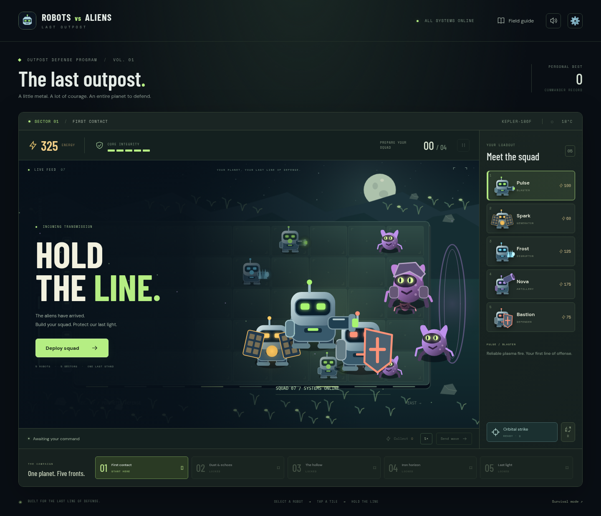

# Robots vs Aliens: Last Outpost

An original sci-fi lane-defense game. Build a squad of robots, manage energy, and defend a remote outpost from an alien invasion. Play in a desktop/mobile browser, install it as an offline web app, or build the included Android application.



## What's playable

- Five robot classes: **Pulse** blaster, **Spark** generator, **Frost** disruptor, **Nova** artillery, and **Bastion** defender.
- Five campaign sectors, escalating waves, five enemy types, final-wave Overlords, and endless survival.
- Original Canvas artwork: animated robots, aliens, lunar landscape, portal, projectiles, particles, health bars, and emergency sweepers.
- Energy pickups, health-based recycling, lane-wide orbital strikes, pause, and double speed.
- Procedural sci-fi sound effects, reduced-motion settings, keyboard navigation, and touch controls.
- Saved campaign unlocks, star ratings, preferences, and best score on the current device.
- Offline production build with bundled fonts; no account, server, API key, ads, or tracking.
- Capacitor Android project, GitHub CI/APK artifacts, optional GitHub Pages publishing, and Azure DevOps CI.

This is a playable first release, not a signed Google Play release. Ongoing battles are not saved when the app closes. See [validation and limitations](docs/VALIDATION.md).

## Run locally

Run game commands from `apps/robots-vs-aliens/`, not the repository root. This application has its own dependency lockfile and native host.

Use **Node.js 22 or newer** (the cloud build also works with Node 24).

```bash
npm ci
npm run dev
```

Open the address Vite prints. For the production version with offline caching:

```bash
npm run build
npm run preview
```

Serve `dist/` over HTTPS for installation on phones. The service worker also works on localhost during development. Visit once online and let the page finish loading before going offline. A browser's install option can add it to the home screen. The native Android app bundles the game and works offline immediately.

## How to play

1. Choose a sector and **Deploy squad**.
2. Select a robot card, then an empty tile. Aliens enter from the right; defend the core on the left.
3. Place Spark generators in the back. Cover threatened lanes with Pulse, then combine Frost and Nova. Put Bastion in front to buy time.
4. Collect golden energy cells. Orbital strike clears a threatened lane; each lane also has one automatic emergency sweeper.
5. Clear every wave to unlock the next sector. Remaining core integrity determines your stars.

| Control                  | Action                                                         |
| ------------------------ | -------------------------------------------------------------- |
| `1`–`5`                  | Select a robot                                                 |
| `Q` then a lane          | Orbital strike                                                 |
| `R` then a robot         | Recycle for up to 50% of its cost                              |
| `E`                      | Collect all visible energy cells                               |
| `Escape` or pause button | Pause / resume                                                 |
| `Space`                  | Pause when focus is not on a button; activate a focused button |
| Arrows + Enter           | Navigate battlefield tiles and deploy                          |

On phones, tap the cards and tiles. Landscape provides larger battlefield tiles. Use the field guide and settings buttons for instructions, audio, and reduced motion.

## Android

Requirements: **Java 21**, Android SDK **36**, Build Tools **35.0.0** (selected by the Android Gradle plugin), and Android SDK licenses accepted. Set `ANDROID_HOME` to your SDK directory (or use an ignored `android/local.properties` file). Minimum supported OS: Android 7 / API 24; a modern Android System WebView is required.

```bash
npm ci
npm run android:sync
cd android
./gradlew --no-daemon --max-workers=2 assembleDebug lintDebug
```

The debug APK is `android/app/build/outputs/apk/debug/app-debug.apk`. Install with `adb install -r <apk-path>` or transfer it to your test phone. It uses a development signing key. **Do not distribute it as a production/store-signed build.** GitHub Actions also builds an APK artifact named `robots-vs-aliens-debug-apk`.

`npm run android:open` opens Android Studio. After web changes, run `npm run android:sync` before rebuilding. Release signing, store listing, privacy disclosures, and physical-device testing are separate release tasks. Keep signing keys out of Git.

## Tests

```bash
npx playwright install chromium
npm run check
```

For an existing system browser:

```bash
PLAYWRIGHT_CHROMIUM_EXECUTABLE_PATH=/usr/bin/chromium npm run check
```

Unit tests cover economy, combat, special attacks, wave progression, victory/defeat, and save validation. Browser tests cover desktop/mobile interaction, pause, offline reload, keyboard deployment, and dialog focus. Screenshots and failure traces are written to `test-results/`.

## Continue with Azure AI

Give your coding agent [docs/AZURE_AI_HANDOFF.md](docs/AZURE_AI_HANDOFF.md). It includes a ready-to-paste continuation prompt, architecture, prioritized improvements, acceptance criteria, and validation commands. `AGENTS.md` provides repository instructions. Azure AI model access alone does not edit or push a repository; use a coding-agent environment with this checkout, shell tools, and scoped GitHub access.

The repository-root [`azure-pipelines.yml`](../../azure-pipelines.yml) builds and tests the web application in Azure DevOps. For hosting, deploy `dist/` to Azure Static Web Apps or use the manual **Publish web game to GitHub Pages** workflow after enabling Pages with GitHub Actions in repository settings. No hosting has been configured merely by committing these workflows.

## Project map

See [architecture](docs/ARCHITECTURE.md), [validation](docs/VALIDATION.md), and [asset credits](docs/ASSETS.md). All game art and synthesized sounds were created for this project. The concept uses the lane-defense genre; no assets or branding from Plants vs Zombies are included.
