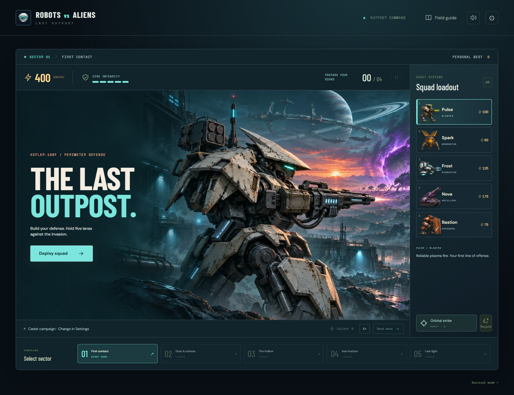

# Robots vs Aliens: Last Outpost

An original sci-fi lane-defense game. Build a squad of robots, manage energy, and defend a remote outpost from an alien invasion. Play in a desktop/mobile browser, install it as an offline web app, or build the included Android application.



## What's playable

- Five robot classes: **Pulse** blaster, **Spark** generator, **Frost** disruptor, **Nova** artillery, and **Bastion** defender.
- Five campaign sectors, escalating waves, five enemy types, final-wave Overlords, and endless survival.
- Each sector has its own battlefield, from the Greenline perimeter and Badlands to the Crystal Basin, Relay Nine and the Nest. Selecting an unlocked sector reveals its location and briefing.
- Choose robot and alien skins independently in Settings. All five aliens have full-body walking and attack animations in each brood, including ranged attacks against defenders. The art is bundled for offline play. [See the aliens in motion](docs/screenshots/alien-motion.webp)
- Expanded lanes gives the battlefield more screen space by default. Settings → Battle layout switches to Classic console at any time. Settings → Battlefield skin changes the floor to Sector alloy, Copper foundry or Polar relay. [Landscape battle](docs/screenshots/field-copper-foundry.webp)
- Energy pickups, health-based recycling, lane-wide orbital strikes, pause, and double speed.
- Procedural sci-fi sound effects, reduced-motion settings, keyboard navigation, and touch controls.
- Saved campaign unlocks, star ratings, preferences, and best score on the current device.
- Offline production build with bundled fonts; no account, server, API key, ads, or tracking.
- Capacitor Android project, GitHub CI/APK artifacts, optional GitHub Pages publishing, and Azure DevOps CI.

The Android package is a development-signed debug build. Campaign unlocks and preferences persist locally. Closing the process ends an ongoing battle. See the [current handoff](HANDOFF.md) and [test record](TESTING.md).

## Run locally

Run game commands from `apps/robots-vs-aliens/`, not the repository root. This application has its own dependency lockfile and native host.

Use **Node.js 22 or newer** (the cloud build also works with Node 24).

```bash
npm ci
npm run dev
```

Open the address Vite prints. For the production version with offline caching:

```bash
npm run build
npm run preview
```

Serve `dist/` over HTTPS for installation on phones. The service worker also works on localhost during development. Visit once online and let the page finish loading before going offline. A browser's install option can add it to the home screen. The native Android app bundles the game and works offline immediately.

## How to play

1. Select an unlocked sector, read its briefing and choose **Deploy squad**. The default **Cadet** campaign lets you set up before the first attack in First Contact. Press **Send wave** when ready. For the original challenge, choose **Veteran** in Settings. Survival always uses Veteran rules.
2. Select a robot card, then an empty tile. Aliens enter from the right; defend the core on the left.
3. Place Spark generators in the back. Cover threatened lanes with Pulse, then combine Frost and Nova. Put Bastion in front to buy time.
4. Tap a gold bolt to collect 35 energy. The Collect button or E gathers every available bolt. Orbital strike clears a threatened lane, and each lane also has one automatic emergency sweeper.
5. Clear every wave to unlock the next sector. Remaining core integrity determines your stars.

| Control                  | Action                                                         |
| ------------------------ | -------------------------------------------------------------- |
| `1`–`5`                  | Select a robot                                                 |
| `Q` then a lane          | Orbital strike                                                 |
| `R` then a robot         | Recycle for up to 50% of its cost                              |
| `E`                      | Collect all visible energy cells                               |
| `Escape` or pause button | Pause / resume                                                 |
| `Space`                  | Pause when focus is not on a button; activate a focused button |
| Arrows + Enter           | Navigate battlefield tiles and deploy                          |

On phones, tap the cards and tiles. Android opens in landscape. Choose **Settings → Screen orientation → Follow phone** to use the phone’s rotation preference. Ordinary browser tabs adapt to the viewport.

On Android, press the system **Back** button during a mission to pause. Press it again to resume with your squad in place. Back closes Settings and the field guide, returns to command from a mission result, and uses ordinary Android navigation on the command screen. On a keyboard, Escape performs the same in-game actions.

Watch the amber arrow on the right of the board to see where the next alien will enter. Cadet also names the alien. In Settings, select robot and alien skins independently. Choose Foundry ceramic for ivory plating and copper joints, or Riftborn obsidian for bone-crested alien silhouettes. Settings previews, robot cards, the field guide and the battlefield reflect your choices. Choices save on this device. [Redmi landscape screenshot](docs/screenshots/redmi-incoming-lane.webp)

## Android

Requirements: **Java 21**, Android SDK **36**, Build Tools **35.0.0** (selected by the Android Gradle plugin), and Android SDK licenses accepted. Set `ANDROID_HOME` to your SDK directory (or use an ignored `android/local.properties` file). Minimum supported OS: Android 7 / API 24; a modern Android System WebView is required.

```bash
npm ci
npm run android:sync
cd android
./gradlew --no-daemon --max-workers=2 assembleDebug lintDebug
```

The debug APK is `android/app/build/outputs/apk/debug/app-debug.apk`. Install with `adb install -r <apk-path>` or transfer it to your test phone. It uses a development signing key. **Do not distribute it as a production/store-signed build.** GitHub Actions also builds an APK artifact named `robots-vs-aliens-debug-apk`.

`npm run android:open` opens Android Studio. After web changes, run `npm run android:sync` before rebuilding. Follow the [USB phone procedure](TESTING.md#reproduce-a-muted-usb-phone-test) for hardware validation. Store publication still requires release signing, a listing and privacy disclosures. Keep signing keys out of Git.

## Tests

```bash
npx playwright install chromium
npm run check
```

For an existing system browser:

```bash
PLAYWRIGHT_CHROMIUM_EXECUTABLE_PATH=/usr/bin/chromium npm run check
```

Unit tests cover economy, combat, special attacks, wave progression, victory/defeat, and save validation. Browser tests cover desktop/mobile interaction, pause, offline reload, keyboard deployment, and dialog focus. Screenshots and failure traces are written to `test-results/`.

## Continue development

The second AI’s assignment, integration branch, asset conventions and acceptance checks are in [ART_HANDOFF.md](ART_HANDOFF.md).

Start with the [agent instructions](AGENTS.md), [development handoff](HANDOFF.md), [testing procedures and results](TESTING.md) and [changelog](CHANGELOG.md). Azure agents can also use the [Azure continuation guide](docs/AZURE_AI_HANDOFF.md).

The repository-root [`azure-pipelines.yml`](../../azure-pipelines.yml) builds and tests the web application in Azure DevOps. For hosting, deploy `dist/` to Azure Static Web Apps or use the manual **Publish web game to GitHub Pages** workflow after enabling Pages with GitHub Actions in repository settings. No hosting has been configured merely by committing these workflows.

## Project map

See [architecture](docs/ARCHITECTURE.md), [validation](docs/VALIDATION.md), and [asset credits](docs/ASSETS.md). All game art and synthesized sounds were created for this project. The concept uses the lane-defense genre; no assets or branding from Plants vs Zombies are included.
